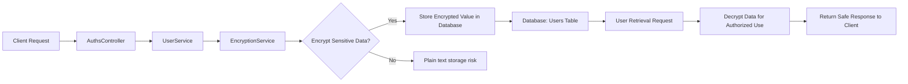
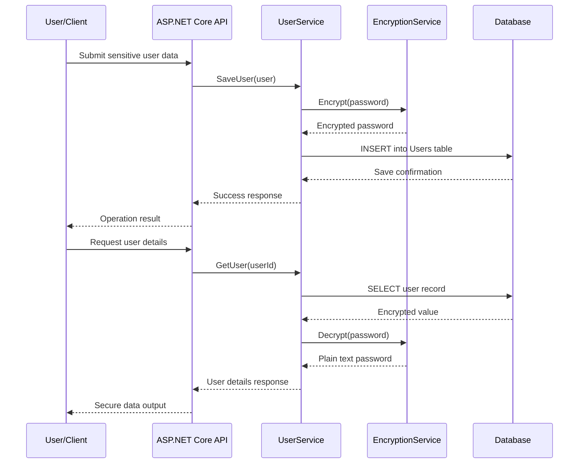

<!--
SEO Keywords:
Sensitive data encryption .NET
AES encryption .NET 8
encrypt sensitive data before storage
ASP.NET Core data protection
secure password storage .NET
cryptography in ASP.NET Core
data encryption at rest .NET
protect personal data in database
C# encrypt before saving to database
Web API security .NET
sensitive data security example
-->

# Sensitive Data Security in .NET 8 | Encrypt Data Before Storage

A practical and secure .NET 8 solution for protecting sensitive data before it is stored in a database. This project demonstrates how to encrypt values such as passwords or confidential records using AES encryption and decrypt them only when needed.

## Overview

This repository showcases a modern approach to data protection in an ASP.NET Core Web API. It focuses on a common security pattern:

- accept sensitive information from the client
- encrypt it before saving to the database
- decrypt it only when retrieving the data for authorized usage

The implementation uses .NET 8, ASP.NET Core, Dapper, and AES encryption to provide a clean example of protecting sensitive information at rest.

## Why This Project Is Important

Sensitive data such as passwords, personal identifiers, private records, and confidential credentials must never be stored in plain text. If a database is compromised, encrypted values significantly reduce the risk of direct exposure.

This repository is useful for developers searching for:

- sensitive data encryption .NET
- AES encryption .NET 8
- encrypt sensitive data before storage
- ASP.NET Core data protection
- secure password storage .NET
- cryptography in ASP.NET Core
- data encryption at rest .NET
- C# encrypt before saving to database
- Web API data security best practices

## Core Features

- AES-based encryption for sensitive fields
- Secure storage of encrypted values in the database
- Decryption on retrieval for legitimate access
- ASP.NET Core Web API implementation
- Dapper-based database access
- Clean architecture for data security examples
- Practical example for enterprise application developers

## Architecture

The application follows a simple but effective layered architecture:

- API layer receives user input and exposes endpoints
- Service layer applies encryption/decryption logic
- Data access layer persists values into the database
- Database stores encrypted sensitive information

## Data Flow Diagram



## Sequential Diagram



## Security Flow

1. The API receives user data from a client request.
2. The service layer calls the encryption component.
3. Sensitive data such as password fields are encrypted before persistence.
4. The encrypted value is saved in the database.
5. When the information is retrieved, it is decrypted only at the application layer.
6. This reduces exposure if the database is accessed without authorization.

## Benefits

- Better data protection: sensitive values are not stored in plain text.
- Reduced risk of direct database exposure.
- Improved compliance posture for privacy-sensitive workloads.
- Strong foundation for secure application design.
- Clear, practical example for .NET developers.
- Useful pattern for handling personal, financial, or user credentials.
- Easy to extend to additional fields and services.

## Use Cases

- Storing user passwords securely in a database
- Protecting personal information in web applications
- Securing API payloads that contain confidential values
- Compliance-focused applications requiring data-at-rest protection
- Enterprise applications with sensitive customer or employee records
- Secure authentication and profile systems
- Internal systems that handle confidential business information

## Technology Stack

- .NET 8
- ASP.NET Core Web API
- C#
- Dapper ORM
- PostgreSQL / SQL database support
- AES encryption
- REST API architecture

## Project Structure

```text
Sensitive-Data-Security/
├── TestRestWebApi/
│   ├── Controllers/
│   ├── Data/
│   ├── Models/
│   ├── Services/
│   ├── Program.cs
│   ├── appsettings.json
│   ├── appsettings.Development.json
│   ├── TestRestWebApi.csproj
│   └── TestRestWebApi.http
├── TestRestWebApi.sln
├── README.md
├── .gitignore
└── .gitattributes
```

## Setup Instructions

### Prerequisites

- .NET 8 SDK
- SQL Server or compatible database
- Visual Studio or VS Code

### Steps

1. Configure your database connection in the project configuration.
2. Set a strong encryption key in the application settings.
3. Restore NuGet packages.
4. Run the API project.
5. Use Swagger or a client tool to send sample user data.
6. Verify the database stores encrypted values rather than plain text.

## Security Notes

- The encryption key must be stored securely and never hardcoded in production.
- Prefer environment variables or secret stores for key management.
- Use HTTPS in production systems.
- Keep encryption keys separate from database records.
- Validate all input before processing and persisting data.

## Search Engine Optimization Recommendation

To improve visibility on GitHub and search engines, use repository metadata and content strategies such as:

- GitHub topics: `dotnet`, `aspnetcore`, `security`, `encryption`, `aes`, `csharp`, `webapi`
- keyword-rich title and description
- structured README with practical examples and diagrams
- external blog or portfolio links
- project screenshots and architecture visuals
- regular commits and documentation updates

## Conclusion

This project is a clear example of how to safeguard sensitive data in a .NET application before it is persisted. It demonstrates a practical security pattern that can be used in real-world APIs, user management systems, and enterprise platforms where privacy and compliance matter.

By applying encryption before storage, developers reduce the chance of unauthorized data exposure and build stronger, more resilient applications.

## License

This project is intended for learning, demo, and development use.

---

Built for secure application development, privacy protection, and modern .NET data security.
